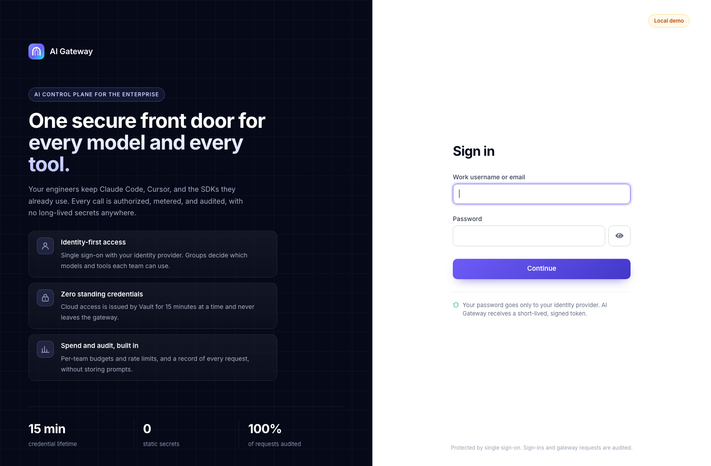

# AI Gateway Platform

[](https://github.com/csraovaradev/ai-gateway-platform/actions/workflows/ci.yml)

**Open-source guardrails for enterprise AI.** A self-hosted, Kubernetes-native gateway that gives every
**LLM call** and **MCP tool call** one governed front door: single sign-on, per-team model and tool
policy, spend limits, and a full audit trail, with **no long-lived secrets** anywhere.

Developers keep the tools they already use (Claude Code, Cursor, the OpenAI and Anthropic SDKs). The
platform team decides who may use which model and which tool, what it may cost, and gets a record of
every request, without storing prompts.

> **Status:** all roadmap phases are built and verified on a laptop and on Amazon EKS. What a
> production rollout still needs is in [docs/production.md](docs/production.md).

---

## The problem

When an organization adopts AI tools, every team ends up wiring its own path to models and tools:

- **Static API keys** for model providers and internal systems are copied into IDE configs, `.env` files, and CI variables.
- **No central visibility** into which team called which model or tool, what it cost, or what data moved.
- **MCP servers multiply** (Jira, Jenkins, Datadog, Vault, internal APIs), each with its own auth and no shared guardrails.
- **Regulated environments** need an audit trail that ad-hoc integrations can't produce.

## The approach

A single gateway, run as a platform service on EKS:

| Plane | What it does |
|---|---|
| **Identity** | Single sign-on through any OIDC identity provider (Entra ID, Okta, Keycloak). Groups map to teams, and every request is attributed to a person. |
| **LLM gateway** | OpenAI-compatible and Anthropic Messages endpoints, so Claude Code, Cursor, and the SDKs work unchanged. Routes to Amazon Bedrock, OpenAI-compatible servers (vLLM, Ollama), or a mock, with streaming, per-team model allowlists, and visible fallback to other models with a circuit breaker. |
| **MCP gateway** | Fronts upstream MCP servers. Clients connect once; the gateway enforces per-team tool allowlists and logs every tool call. |
| **Credential broker** | HashiCorp Vault issues **short-lived, scoped credentials** per request. Gateway pods authenticate to Vault with their Kubernetes service account, so no provider keys live in the cluster. |
| **Content guardrails** | Secrets and personal data in prompts are redacted, blocked, or audited per team before they reach a model provider; the audit log records the kind, never the value. |
| **Policy & metering** | Rate limits, budgets, and cost attribution per team and per signed-in person. |
| **Observability** | OpenTelemetry traces and metrics for every request (latency, tokens, cost, tool usage), plus a structured audit log. |

## Architecture

<p align="center">
  
</p>

### Request flow (LLM call)

1. A client calls `POST /v1/chat/completions` with its team identity (OIDC token or gateway-issued key).
2. The gateway checks policy: is the team allowed this model, and is it within its rate limit and budget?
3. The router asks Vault for a short-lived credential for the target provider (for example, dynamic AWS credentials for Bedrock).
4. The request is forwarded and the response is streamed back.
5. Tokens, latency, cost, and outcome are emitted as OTel spans and metrics and written to the audit log.

## Get started

One gateway image and one policy format, three ways to run it
([docs/getting-started.md](docs/getting-started.md) walks through each):

| Level | Command | You need | What you get |
|---|---|---|---|
| **1. Try it** | `make quickstart` | Docker | Gateway, mock model, demo MCP server, demo keys. Works with curl, OpenAI and Anthropic SDKs, and Claude Code |
| **2. Full local stack** | `make local` | Docker (+ AWS for real models) | Adds SSO sign-in (Keycloak), Vault-issued credentials, Redis, Claude on Bedrock, Prometheus, Grafana, Jaeger |
| **3. Production** | Terraform + `scripts/eks-deploy.sh` | An AWS account | EKS, Vault with KMS auto-unseal and IRSA, ElastiCache, NetworkPolicy; `mode: production` policies |

```bash
git clone https://github.com/csraovaradev/ai-gateway-platform.git && cd ai-gateway-platform
make quickstart                     # http://127.0.0.1:8080 (AIGW_PORT=8081 make quickstart if taken)

curl -s http://127.0.0.1:8080/v1/chat/completions -H "Authorization: Bearer dev-platform-key" \
  -H "Content-Type: application/json" \
  -d '{"model": "mock-echo", "messages": [{"role": "user", "content": "hello"}]}'

# Claude Code through the gateway: no Anthropic or AWS key on the laptop
ANTHROPIC_BASE_URL=http://127.0.0.1:8080 ANTHROPIC_AUTH_TOKEN=dev-platform-key \
  ANTHROPIC_MODEL=mock-echo ANTHROPIC_DEFAULT_HAIKU_MODEL=mock-echo claude
```

Clone under your home directory: Docker Desktop and Colima share only that with containers by default.
`dev-platform-key` and `dev-data-key` are public demo keys, for your laptop only. A policy with
`mode: production` refuses to start with them, or with any other laptop-only setting
([ADR-0008](docs/adr/0008-run-modes.md)); check a policy with `python -m aigw.check --production`.

<p align="center">
  
</p>

At level 2 developers sign in instead of sharing keys: `scripts/aigw-login login` (like `aws sso login`),
then Claude Code gets fresh 15-minute tokens on its own through `apiKeyHelper`
([ADR-0007](docs/adr/0007-user-identity-oidc.md)). Recipes for each feature from source are in
[docs/guides.md](docs/guides.md).

## Verified end to end

Not just written, run: on a laptop, in kind, and on Amazon EKS against Claude models on Bedrock.

- **Claude Code through the gateway on EKS:** tools, streaming, extended thinking, and prompt caching
  work, and the gateway's cost for the session matched Claude Code's own figure to the cent.
- **Least privilege for agents:** Claude Code running as the data team never sees `delete_issue`; a
  call to it is refused at the gateway and never reaches the MCP server.
- **No AWS access key anywhere on EKS:** the gateway logs in to Vault with its service account, Vault
  assumes a Bedrock-only role through IRSA, and credentials live 15 minutes. Vault auto-unseals with KMS,
  and came back on its own when AWS reclaimed both Spot nodes mid-test.
- **Signed-in users, not shared keys:** every audit line names the person, and a token that is edited,
  expired, or for another app is refused.
- **Fallback that is never silent:** with Sonnet pointed at an unreachable region, real Claude Haiku
  answered, the response named the model that served it, cost was priced as Haiku, and after three
  failures the circuit breaker skipped Sonnet entirely. Claude Code kept working.
- **Secrets stay inside:** with an AWS key pasted into a Claude Code prompt, the model only ever saw
  `[REDACTED:aws_access_key_id]` across a multi-turn write-and-read task, and the key appeared
  nowhere in the gateway's logs.
- **Failure modes tested:** Vault down, hung upstreams, leaky upstream errors, oversized bodies, and a
  laptop sleeping past its credentials' lifetime (found live, fixed, and now a test).
- **CI on every push:** 141 tests, lint, a production-mode check of the example policies, Terraform
  validate, Helm lint, ShellCheck, Prometheus rule checks, and the Docker build.

## Repository layout

```
ai-gateway-platform/
├── gateway/          # Gateway service: API, auth, policy, LLM router, MCP proxy (aigw/mcp.py)
├── compose.yaml      # Level 1: Docker-only quickstart (compose.full.yaml adds level 2)
├── terraform/        # EKS, networking, IAM (IaC)
├── helm/             # Helm chart for the gateway
├── deploy/           # Values for EKS (deploy/eks) and the local Keycloak realm (deploy/local)
├── vault/            # Vault policies
├── observability/    # Prometheus SLO rules, Grafana dashboard, local stack
├── scripts/          # Setup scripts, EKS deploy and demo, aigw-login (SSO for Claude Code)
├── policies/         # Example policies: quickstart, local, Claude Code, production
├── docs/             # Getting started, guides, production, ADRs, threat model
└── examples/         # Demo MCP server and client, Claude Code and Cursor settings
```

## Roadmap

- [x] **Phase 0: Foundation.** Terraform for VPC and EKS, Vault integration, CI with lint, test, and image build.
- [x] **Phase 1: LLM gateway.** OpenAI-compatible endpoint with streaming, routing to Bedrock plus one hosted provider, and team auth.
- [x] **Phase 2: Zero static secrets.** Vault Kubernetes auth and dynamic AWS credentials for Bedrock, with provider keys leased per request.
- [x] **Phase 3: MCP gateway.** Proxy for Streamable HTTP MCP servers, per-team tool allowlists, and a tool-call audit log.
- [x] **Phase 4: Policy & metering.** Rate limits, token budgets, and per-team cost attribution.
- [x] **Phase 5: Observability.** OTel traces and metrics, dashboards, and SLOs for latency and availability.
- [x] **Phase 6: Hardening.** mTLS between components, NetworkPolicies, a threat model, and failure-mode tests.
- [x] **Claude Code support.** Anthropic Messages API with tools, thinking, prompt caching, and cache-aware cost.
- [x] **MCP on behalf of people.** MCP servers receive a token issued to them for the signed-in person (OAuth token exchange), never the person's own token.
- [x] **Per-person limits.** Rate limits and budgets for each signed-in person, so one runaway agent cannot lock out a team.
- [x] **Content guardrails.** Secrets and personal data in prompts are redacted, blocked, or audited before they leave.
- [x] **Fallback and circuit breaking.** A throttled or failing model falls back to another, visibly and within policy.
- [x] **Identity and run modes.** SSO sign-in through any OIDC provider, per-user audit, production-mode guardrails, and one-command local stacks.

## Design decisions

Key choices are recorded as ADRs in [`docs/adr/`](docs/adr/):

- [0001](docs/adr/0001-vault-dynamic-aws-credentials.md) Vault-issued short-lived AWS credentials
- [0002](docs/adr/0002-mcp-gateway.md) MCP gateway in the same service, body-authoritative policy
- [0003](docs/adr/0003-shared-state-and-metering.md) Shared state in Redis, budgets and metering
- [0004](docs/adr/0004-observability.md) Metrics from audit events, traces, SLOs
- [0005](docs/adr/0005-transport-security-and-isolation.md) TLS, NetworkPolicy, no service mesh yet
- [0006](docs/adr/0006-anthropic-messages-api.md) Anthropic Messages API for Claude Code
- [0007](docs/adr/0007-user-identity-oidc.md) User identity through the company identity provider
- [0008](docs/adr/0008-run-modes.md) Development and production run modes
- [0009](docs/adr/0009-fallback-and-circuit-breaking.md) Model fallback and circuit breaking
- [0010](docs/adr/0010-content-guardrails.md) Content guardrails for secrets and personal data
- [0011](docs/adr/0011-per-user-limits.md) Per-person rate limits and budgets
- [0012](docs/adr/0012-mcp-on-behalf-of.md) MCP calls on behalf of the signed-in person

## Contributing and security

Issues and pull requests are welcome: see [CONTRIBUTING.md](CONTRIBUTING.md). Please report security
problems privately, as described in [SECURITY.md](SECURITY.md). Changes are listed in
[CHANGELOG.md](CHANGELOG.md).

## License

[Apache 2.0](LICENSE)
