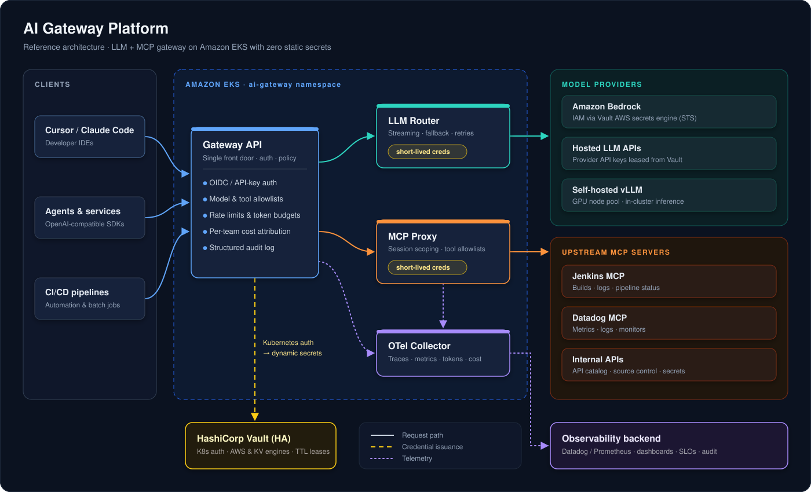

# AI Gateway Platform

[](https://github.com/csraovaradev/ai-gateway-platform/actions/workflows/ci.yml)

A self-hosted, Kubernetes-native gateway for AI workloads: one front door for **LLM calls** and **MCP tool calls**, with **no long-lived secrets**, per-team policy, and full audit.

> **Status:** 🚧 Under active development. See the [Roadmap](#roadmap) for what works today.

---

## The problem

When an organization adopts AI tools, every team ends up wiring its own path to models and tools:

- **Static API keys** for model providers and internal systems are copied into IDE configs, `.env` files, and CI variables.
- **No central visibility** into which team called which model or tool, what it cost, or what data moved.
- **MCP servers multiply** (Jira, Jenkins, Datadog, Vault, internal APIs), each with its own auth and no shared guardrails.
- **Regulated environments** need an audit trail that ad-hoc integrations can't produce.

## The approach

A single gateway, run as a platform service on EKS:

| Plane | What it does |
|---|---|
| **LLM gateway** | OpenAI-compatible endpoint that routes to Amazon Bedrock, hosted providers, or self-hosted models (vLLM). Handles streaming, fallback, and model allowlists. |
| **MCP gateway** | Fronts upstream MCP servers. Clients connect once; the gateway enforces per-team tool allowlists and logs every tool call. |
| **Credential broker** | HashiCorp Vault issues **short-lived, scoped credentials** per request. Gateway pods authenticate to Vault with their Kubernetes service account, so no provider keys live in the cluster. |
| **Policy & metering** | Per-team rate limits, token budgets, and cost attribution. |
| **Observability** | OpenTelemetry traces and metrics for every request (latency, tokens, cost, tool usage), plus a structured audit log. |

## Architecture

<p align="center">
  
</p>

### Request flow (LLM call)

1. A client calls `POST /v1/chat/completions` with its team identity (OIDC token or gateway-issued key).
2. The gateway checks policy: is the team allowed this model, and is it within its rate limit and budget?
3. The router asks Vault for a short-lived credential for the target provider (for example, dynamic AWS credentials for Bedrock).
4. The request is forwarded and the response is streamed back.
5. Tokens, latency, cost, and outcome are emitted as OTel spans and metrics and written to the audit log.

## Repository layout

```
ai-gateway-platform/
├── gateway/          # Gateway service: API, auth, policy, LLM router, MCP proxy (aigw/mcp.py)
├── terraform/        # EKS, networking, IAM, Vault config (IaC)
├── helm/             # Helm charts for the gateway (OTel collector to come)
├── vault/            # Vault policies
├── scripts/          # Local Vault setup (dev server and kind)
├── policies/         # Example team policies (models, tools, quotas)
├── docs/             # Architecture decisions, threat model, runbooks
└── examples/         # Demo MCP server and client
```

## Roadmap

- [ ] **Phase 0: Foundation.** Terraform for VPC and EKS, Vault integration, CI with lint, test, and image build.
- [x] **Phase 1: LLM gateway.** OpenAI-compatible endpoint with streaming, routing to Bedrock plus one hosted provider, and team auth.
- [x] **Phase 2: Zero static secrets.** Vault Kubernetes auth and dynamic AWS credentials for Bedrock, with provider keys leased per request.
- [x] **Phase 3: MCP gateway.** Proxy for Streamable HTTP MCP servers, per-team tool allowlists, and a tool-call audit log.
- [x] **Phase 4: Policy & metering.** Rate limits, token budgets, and per-team cost attribution.
- [x] **Phase 5: Observability.** OTel traces and metrics, dashboards, and SLOs for latency and availability.
- [x] **Phase 6: Hardening.** mTLS between components, NetworkPolicies, a threat model, and failure-mode tests.

## Design decisions

Key choices are recorded as ADRs in [`docs/adr/`](docs/adr/), including:

- Why a gateway instead of SDK-level controls
- Why Vault dynamic secrets instead of Kubernetes Secrets
- How MCP sessions are proxied and scoped per team

## Quick start

Run the gateway locally with the mock model (no cloud credentials needed):

```bash
cd gateway
make install          # creates .venv and installs dependencies
make test             # runs the test suite
make run              # starts the gateway on http://localhost:8080
```

In another terminal:

```bash
curl -s http://localhost:8080/v1/chat/completions \
  -H "Authorization: Bearer dev-platform-key" \
  -H "Content-Type: application/json" \
  -d '{"model": "mock-echo", "messages": [{"role": "user", "content": "hello"}]}'
```

`dev-platform-key` and `dev-data-key` are public demo keys defined in
[`policies/gateway.example.yaml`](policies/gateway.example.yaml) for local use only.
Generate real keys with `python -m aigw.keys <team>`; the gateway stores only their SHA-256 hashes.

Because the API is OpenAI-compatible, existing SDKs work by changing the base URL:

```python
from openai import OpenAI

client = OpenAI(base_url="http://localhost:8080/v1", api_key="dev-platform-key")
print(client.chat.completions.create(
    model="mock-echo", messages=[{"role": "user", "content": "hi"}]
).choices[0].message.content)
```

For real models, `bedrock-claude` calls Amazon Bedrock with your AWS credentials (your account needs
Bedrock access to Claude Haiku 4.5 in `us-west-2`), and `local-llama` points at any OpenAI-compatible
server such as Ollama or vLLM.

### Upstream credentials from Vault

With [`policies/gateway.vault.example.yaml`](policies/gateway.vault.example.yaml) the gateway holds no
cloud keys at all: it leases 15-minute STS credentials for Bedrock from Vault's AWS secrets engine and
reads upstream API keys from Vault KV ([ADR-0001](docs/adr/0001-vault-dynamic-aws-credentials.md)).

```bash
# 1. IAM role the gateway's credentials are scoped to (Bedrock invoke only), plus Vault's IAM user
terraform -chdir=terraform/iam-bedrock init && terraform -chdir=terraform/iam-bedrock apply

# 2. Dev Vault (in-memory; leave it running in its own terminal)
vault server -dev -dev-root-token-id=root

# 3. Configure Vault and get a gateway token limited to the aigw policy
scripts/vault-dev-setup.sh          # prints: export VAULT_TOKEN=...

# 4. Run the gateway against Vault
cd gateway && make run CONFIG=../policies/gateway.vault.example.yaml
```

### On Kubernetes (kind) with no secrets in the pod

The [Helm chart](helm/aigw) mounts no Kubernetes API token and no Vault token. The pod presents a
projected service-account token whose audience is only `vault`; Vault verifies it and returns a token
limited to the `aigw` policy.

```bash
kind create cluster --name aigw
docker build -t ai-gateway:dev gateway && kind load docker-image ai-gateway:dev --name aigw
helm install vault hashicorp/vault -n vault --create-namespace --kube-context kind-aigw \
  --set server.dev.enabled=true --set server.dev.devRootToken=root --set injector.enabled=false
scripts/vault-k8s-setup.sh
helm install aigw helm/aigw -n aigw --create-namespace --kube-context kind-aigw
kubectl --context kind-aigw -n aigw port-forward svc/aigw 8090:8080
```

Then call model `mock-via-vault` on `localhost:8090`. That model reads its upstream key from Vault,
so a 200 proves the pod logged in to Vault with only its service-account identity.

### MCP tool calls

MCP servers listed under `mcp_servers` are reachable at `/mcp/{name}` with the same team keys
([ADR-0002](docs/adr/0002-mcp-gateway.md)). Each team's `allowed_tools` (`server/tool` globs) decides
which tools it can call; `tools/list` only shows those tools. Every request writes an `event: "mcp"`
audit line with team, server, method, and tool, never arguments or results. Both the session-based
protocol versions and the stateless 2026-07-28 version work.

```bash
cd gateway && .venv/bin/pip install -e ".[mcp-demo]"
.venv/bin/python ../examples/mcp-demo/server.py &        # demo "jira" MCP server on :9000
make run &                                                # gateway on :8080

.venv/bin/python ../examples/mcp-demo/client.py dev-data-key
# visible tools: ['search', 'get_issue']
# get_issue: ok: Gateway returns 502 when Vault is sealed
# delete_issue: refused: tool 'delete_issue' is not allowed for team 'data'
```

### Budgets and cost attribution

Give a model a `price` (USD per million tokens) and every audit line carries `cost_usd`. Give a team a
`budget` and it gets `429 insufficient_quota` once its spend for the day or month reaches it; free
models stay usable. Streamed requests are metered too. With `store: {backend: redis}` rate limits,
budgets, and MCP sessions are shared by all replicas ([ADR-0003](docs/adr/0003-shared-state-and-metering.md)).

```bash
python -m aigw.report audit.log               # or: kubectl logs deploy/aigw | python -m aigw.report
# data  $0.000364
#   model                  requests  denied  errors   in tokens  out tokens     cost USD
#   bedrock-claude                4       2       0          34          66     0.000364
```

### Metrics, traces, and SLOs

`/metrics` serves Prometheus metrics built from the same events as the audit log (requests, denials,
latency, tokens, cost), labelled only with values from the policy file. With
`OTEL_EXPORTER_OTLP_ENDPOINT` set, requests are traced over OTLP using the GenAI semantic
conventions, and each audit line carries its `trace_id`. SLOs (99.5% availability, 95% of
non-streaming requests under 10 s) and burn-rate alerts are in
[`observability/prometheus/rules.yaml`](observability/prometheus/rules.yaml)
([ADR-0004](docs/adr/0004-observability.md)).

```bash
docker compose -f observability/docker-compose.yaml up -d     # AIGW_PORT=8081 if 8080 is taken
cd gateway && OTEL_EXPORTER_OTLP_ENDPOINT=http://127.0.0.1:4318 make run
# Grafana http://127.0.0.1:3000   Prometheus http://127.0.0.1:9090   Jaeger http://127.0.0.1:16686
```

### Hardening

The [threat model](docs/threat-model.md) walks every trust boundary with STRIDE and links each threat to
its mitigation. Phase 6 closed the gaps it found ([ADR-0005](docs/adr/0005-transport-security-and-isolation.md)):

- Upstream errors no longer reach clients (they can contain ARNs, account IDs, or Vault paths); clients
  get a generic message and the `request_id`, the audit log keeps the detail.
- Request bodies over 1 MiB get 413, including chunked uploads.
- Bedrock calls have a 5 s connect timeout, a per-model read timeout, and at most 2 attempts.
- Vault and Redis connections can pin a CA and present a client certificate (`vault.tls`, `store.tls`).
- The Helm chart ships a NetworkPolicy (API clients and Prometheus in, DNS/Vault/Redis/HTTPS out) and an
  Ingress that routes only `/v1` and `/mcp`, so `/metrics` stays internal.

[`tests/test_failure_modes.py`](gateway/tests/test_failure_modes.py) covers Vault down, hung upstreams
and MCP servers, leaky upstream errors, and oversized bodies.

## License

[Apache 2.0](LICENSE)
